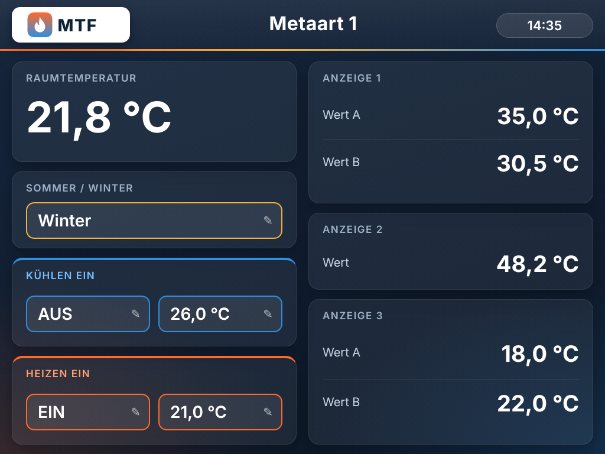
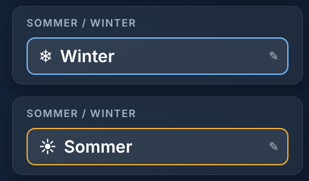

# Meta-Visualisierung
Visualisierung und Regelungssimulation für Heizungssysteme („Meta Visualisierung“) – C.M.I.-Webseite (Technische Alternative) im MTF-Design.



## Ordner
| Ordner | Inhalt |
|---|---|
| `cmi/` | Dateien für das C.M.I.: `1.html`, `1.cgi`, `1.png`, `config.tas` |
| `original/` | Ursprüngliche Dateien (zum Vergleich / Zurücksetzen) |
| `tools/` | Hintergrund-Vorlage, MTF-Logo, Render-Skript |
| `docs/` | Bilder für diese Beschreibung |

**Schnellstart:** `MTF_Visualisierung_CMI.zip` herunterladen, entpacken und die vier Dateien auf dem C.M.I. an derselben Stelle wie die alten ersetzen.

## Funktion
Alle Werte (`c o c …`-Zeilen), die einstellbaren Felder (`class="changex2"` + `adresse`) und `config.tas` sind unverändert.
Die einstellbaren Felder haben einen farbigen Rahmen und ein ✎-Symbol – ein Klick öffnet wie bisher die Eingabe.

### Sommer / Winter
Der Eingangsparameter wird als Betriebsart angezeigt: **EIN → ❄ Winter** (blauer Rahmen), **AUS → ☀ Sommer** (gelber Rahmen).
Das erledigt ein kleines Skript in `cmi/1.html` (Abschnitt `MTF-BETRIEBSART`); es ändert nur die Anzeige, nicht den Wert im Regler.



## MTF-Logo tauschen
Das Logo liegt in `tools/mtf_logo.png`. Zum Tauschen die Datei ersetzen und ausführen:

```
node tools/render.js
```

Das erzeugt `cmi/1.png` (Hintergrund mit Logo) und `vorschau.png` neu. Danach die ZIP-Datei neu packen.

## Beschriftungen ändern
Die Beschriftungen stehen als Text in `cmi/1.cgi` (z. B. `Wärmepumpe 1`, `Vorlauftemperatur`) und können direkt angepasst werden.
